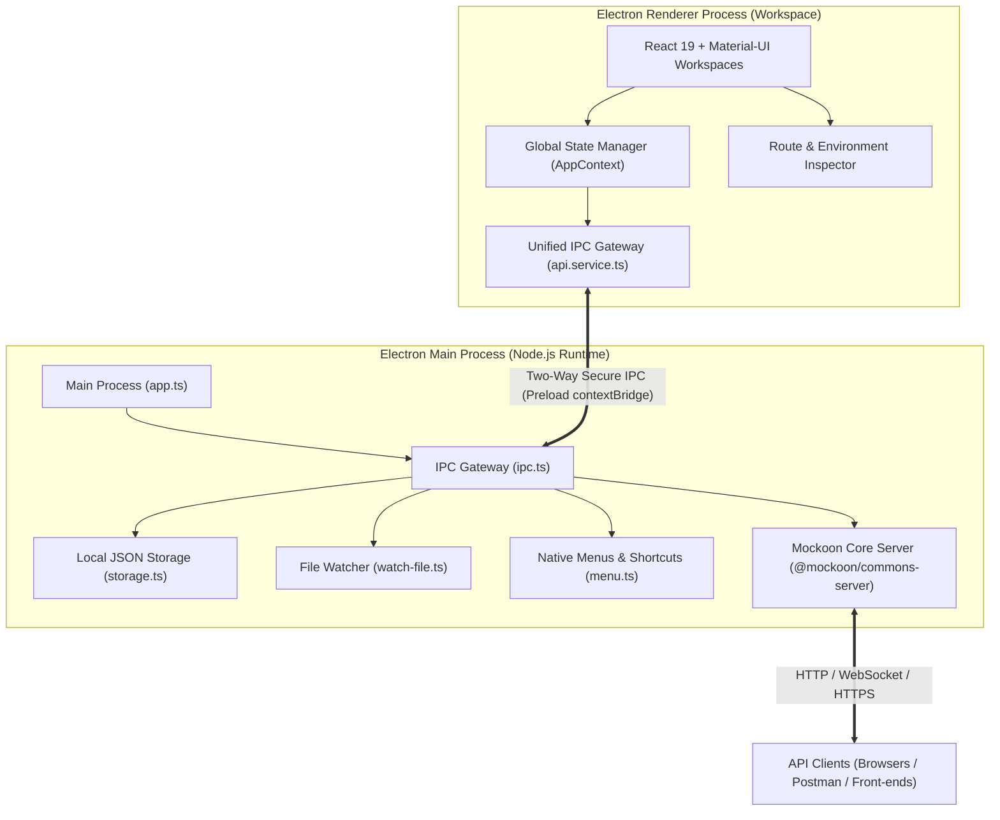

<p align="center">
  
</p>

<p align="center">
  <h1 align="center">MockPulse</h1>
  <p align="center">
    <strong>Modern, Ultra-fast, 100% Offline Local API Mocking and Simulation Workspace</strong>
  </p>
  <p align="center">
    <a href="./README.md">简体中文</a> | <a href="./README.en.md">English</a>
  </p>
  <p align="center">
    <a href="./LICENSE"></a>
    <a href="https://github.com/mockoon/mockoon"></a>
    <a href="https://www.electronjs.org/"></a>
    <a href="https://react.dev/"></a>
    <a href="https://vite.dev/"></a>
    <a href="https://mui.com/"></a>
    
  </p>
</p>

---

## 📢 Special Acknowledgment & Fork Declaration

**MockPulse** is a modernized full-stack secondary development and extensive overhaul based on the renowned open-source project [**Mockoon**](https://github.com/mockoon/mockoon).

* **Mockoon Official Website**: [https://mockoon.com](https://mockoon.com)
* **Mockoon GitHub Repository**: [https://github.com/mockoon/mockoon](https://github.com/mockoon/mockoon)
* **Mockoon Open-Source License**: [MIT License](https://github.com/mockoon/mockoon/blob/main/LICENSE.md)

### Why MockPulse?
Mockoon is an extraordinary API mocking solution. However, as it transitioned into commercial offerings, cloud accounts, remote authentication, and telemetry tracking were introduced. Furthermore, its front-end architecture was built on legacy technology stacks, which impacted cold start speed, high-density dashboard layouts, and strict air-gapped privacy.

MockPulse inherits Mockoon's robust core simulation engines (`@mockoon/commons-server`, template parser, and schema models) while executing a complete **next-generation architectural overhaul**:
1. **100% Offline & Private**: Zero remote telemetry, no sign-in requirements, and no cloud sync. All data lives safely on your local disk, perfectly suited for air-gapped enterprise environments.
2. **Next-Gen Tech Stack**: Rebuilt from Angular to **React 19 + TypeScript + Material-UI (MUI v5) + Vite 8**, delivering 5x faster cold boots and instant hot-module replacements.
3. **Refined UX & Material 3 Aesthetics**: Tailored with native Light and Dark themes, 5 designer color palettes, resizable panel splitters, browser-style URL bars, and compact typography.
4. **100% Mockoon Compatibility**: Fully compatible with Mockoon environment files (`.json`) with seamless two-way OpenAPI / Swagger v2 & v3 import and export.

---

## ✨ Features

### 🔒 Air-Gapped Privacy & Offline First
- **Zero Cloud Dependence**: No tracking, no user registration, and no telemetry calls. Works reliably offline.
- **Local JSON Storage**: Complete ownership of your environment data with real-time file-system watching.

### ⚡ Blazing-Fast Performance
- **Vite 8 Driven**: Sub-second cold starts and instantaneous Hot Module Replacement (HMR).
- **React 19 & Material-UI**: Fluid animations, responsive controls, and high-performance list rendering.

### 🎨 Visual Polish & Customization
- **Seamless Light & Dark Modes**: Native color schemes without high-contrast dialog flickers.
- **5 Palette Presets**: Modern Indigo, Emerald Teal, Cyber Purple, Sunset Amber, and Slate Minimal.
- **Density Controls**: Choose between **Compact (Default)** for data density or **Comfortable** for spacious browsing.
- **Collapsible Sidebar**: Shrink the environments drawer to a 52px icon rail with real-time breathing status indicators.

### 🛠️ Comprehensive Mocking Toolkit
* **Independent Multi-Environment Engine**:
  - Run multiple environments simultaneously on isolated ports with automatic collision-free port allocation.
  - Live status breathing dot and unified start/stop controls.
  - Quick environment duplication, renaming, exporting, and reveal in Finder / Explorer.
* **Versatile Route Types & Folder Hierarchy**:
  - **HTTP Routes**: Micro badges for GET, POST, PUT, PATCH, DELETE, OPTIONS, and HEAD.
  - **CRUD Routes**: Automatically generate complete RESTful collections (GET list, GET /:id, POST, PUT, DELETE) with customizable key fields.
  - **WebSocket Routes**: Real-time bi-directional messaging supporting Unicast, Broadcast, and streaming intervals.
  - **Infinite Nested Folders**: Organize routes into hierarchical folders with fluid drag-and-drop reordering.
  - **Flexible Actions**: Temporarily enable/disable routes, duplicate routes locally or transfer them across environments.
* **Multiple Response Branches & Dispatch Modes**:
  - Define unlimited response branches per route (e.g. 200 OK, 400 Bad Request, 401 Unauthorized, 500 Error).
  - **5 Dispatch Modes**: Rules matching, Random, Sequential round-robin, Disable rules (Default only), and Fallback.
  - **3 Response Body Types**: Inline editor (JSON/XML/Text), Local File (with Finder reveal and default-app opening), and Data Bucket generated.
  - **Fine-Grained Controls**: Dedicated toggles for "Disable Templating" and "Fallback to 404 on Missing File".
* **Advanced Rules Engine**:
  - **11 Match Targets**: Headers, Query params, Body JSONPath, Route params (`:id`), Cookies, Path, Method, Request Count, Global Vars, Data Buckets, and Templating helpers.
  - **7 Operators**: Equals (`=`), Regex match, Regex case-insensitive, Is Null, Empty Array, Array Includes, and Valid JSON Schema.
  - **Logical Evaluators**: Switch between "Match ANY (OR)" and "Match ALL (AND)", with individual rule inversion (Invert / NOT).
* **Asynchronous Webhook Callbacks**:
  - Dedicated webhook template library.
  - Asynchronously dispatch HTTP calls to third-party endpoints upon response delivery with custom delays (Latency in ms).
* **Dynamic Data Buckets**:
  - Integrated with **Faker.js** and **Handlebars** syntax to generate dynamic datasets (mock user personas, mock transactional logs, etc.).
* **Transparent Proxy Mode**:
  - Automatically forward unmatched requests to an upstream backend server.
  - Prefix stripping support (`proxyRemovePrefix`).
  - Configure custom **Proxy Request Headers** and **Proxy Response Headers**.
* **Live Inspection Logs (Request Logs)**:
  - High-density two-line transaction stream with status badges and relative timestamps.
  - Inspect complete request (Headers, Query, Params, Body) and response payloads.
  - Create new mock routes directly from logged requests with one click.
* **OpenAPI / Swagger 1:1 Two-Way Interoperability**:
  - Import specifications via URL, local file browse, or direct editor pasting (OpenAPI v2 & v3).
  - Export environments directly into standard **OpenAPI v3 (JSON / YAML)** specifications.
* **Network & Security**:
  - Bind to `0.0.0.0` (Local Area Network) or `localhost` (Machine only).
  - Configure default global latency and inject CORS preflight headers with one click.
  - Custom TLS/HTTPS support using PFX or PEM certificates.

---

## 🏗️ Architecture



---

## 📦 Download & Installation

Grab the latest pre-built package from [GitHub Releases](https://github.com/webzhouyan/mockpulse/releases):

| Operating System | Package Format | Recommended Architecture |
| :--- | :--- | :--- |
| **macOS** | `.dmg` | **Apple Silicon (M1/M2/M3/M4, arm64)** or **Intel (x64)** |
| **Windows** | `.exe` / `.zip` | **Windows 10 / 11 (x64)** |
| **Linux** | `.AppImage` / `.deb` / `.rpm` | **Ubuntu / Debian / Fedora / CentOS** |

> [!TIP]
> ### 🍎 macOS Note: Fixing "MockPulse.app is damaged and can't be opened"
>
> Because MockPulse is an independent open-source project without a paid Apple commercial developer certificate ($99/year), macOS Gatekeeper automatically quarantines packages downloaded through web browsers (Chrome/Safari) and displays a false-positive warning: *"MockPulse.app is damaged and can't be opened. You should move it to the Trash."*
>
> **The app is completely safe and undamaged. Run this single command in Terminal to bypass Gatekeeper (only needed once):**
>
> ```bash
> sudo xattr -rd com.apple.quarantine /Applications/MockPulse.app
> ```
> *Press Enter and type your Mac login password (characters will not show while typing, just hit Enter). You can now open MockPulse normally!*
>
> Alternatively, go to **System Settings ➔ Privacy & Security**, scroll down to **Security**, and click **"Open Anyway"**.

---

## 🛠️ Local Development & Build

### Prerequisites
- **Node.js**: `>= 22.12.0` (Node 22 LTS recommended)
- **npm**: `>= 10.0.0`

### 1. Clone the repository
```bash
git clone https://github.com/webzhouyan/mockpulse.git
cd mockpulse
```

### 2. Install dependencies
```bash
npm install
```

### 3. Run development mode
```bash
# Build desktop dev assets
npm run build:desktop:dev

# Launch Electron dev window
npm run start:desktop:dev
```

### 4. Build desktop packages
```bash
# macOS (Apple Silicon arm64)
npm run package:desktop:mac:arm64

# macOS (Intel x64)
npm run package:desktop:mac:x64

# Linux
npm run package:desktop:linux

# Windows
npm run package:desktop:win
```
Output artifacts are saved in the `packages/app/packages/` folder.

---

## 📝 Changelog

Detailed release notes, feature changes, and bug fixes for each version are documented in [CHANGELOG.md](./CHANGELOG.md).

---

## 🤝 Contributing

Issues and pull requests are welcomed! Feel free to submit feedback or feature suggestions.

1. Fork the repo and create your branch: `git checkout -b feature/awesome-feature`
2. Commit your changes: `git commit -m 'feat: add some awesome feature'`
3. Push to your branch: `git push origin feature/awesome-feature`
4. Submit a Pull Request

---

## 📄 License & Attribution

* Licensed under the [MIT License](./LICENSE).
* Special gratitude to Guillaume Benoist and the Mockoon community. Mockoon and its logo are trademarks of their respective owners.
* Copyright (c) 2026 MockPulse Contributors / Originally created by Guillaume Benoist (Mockoon).