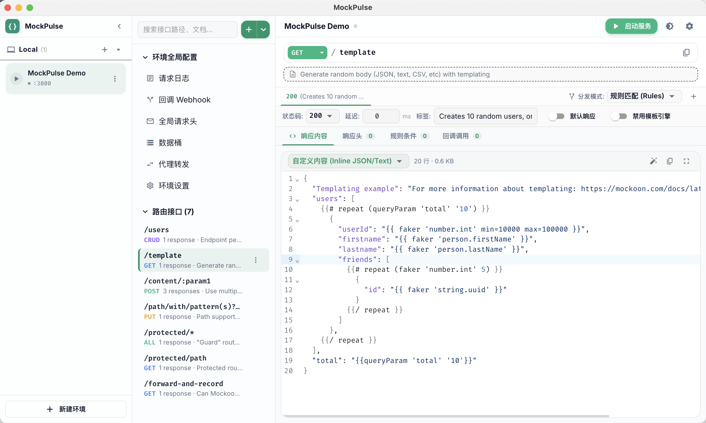
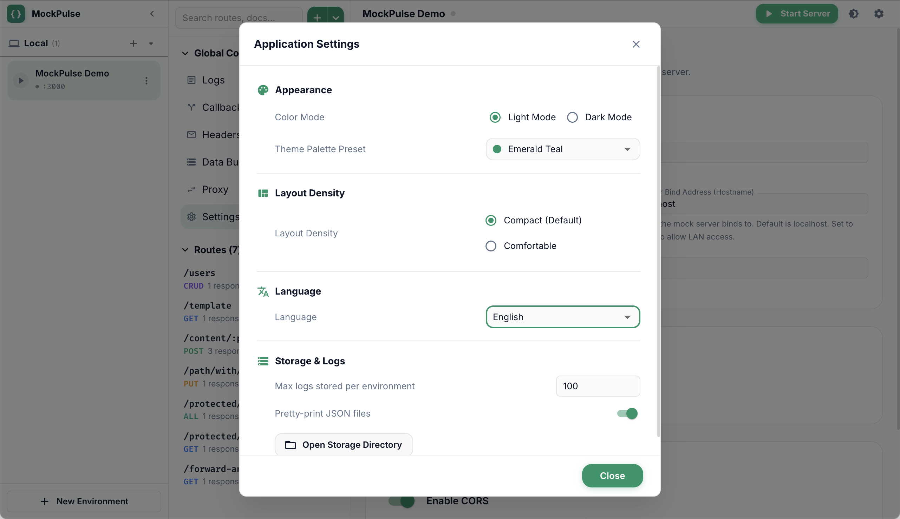
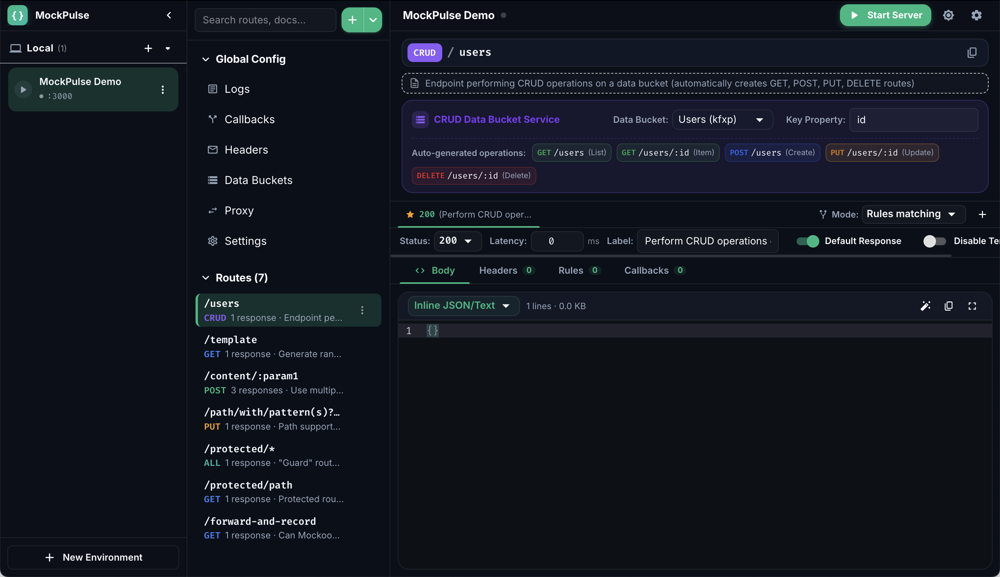
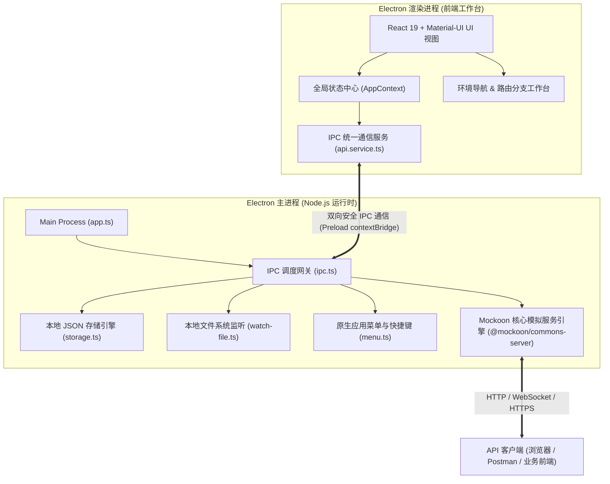

<p align="center">
  
</p>

<p align="center">
  <h1 align="center">MockPulse</h1>
  <p align="center">
    <strong>现代化、极速、纯本地离线的 API 模拟与调试工作台</strong>
  </p>
  <p align="center">
    <a href="./README.md">简体中文</a> | <a href="./README.en.md">English</a>
  </p>
  <p align="center">
    <a href="./LICENSE"></a>
    <a href="https://github.com/mockoon/mockoon"></a>
    <a href="https://www.electronjs.org/"></a>
    <a href="https://react.dev/"></a>
    <a href="https://vite.dev/"></a>
    <a href="https://mui.com/"></a>
    
  </p>
</p>

<p align="center">
  
</p>

---

## 📢 特别致谢与二次开发声明

**MockPulse** 是基于知名开源项目 [**Mockoon**](https://github.com/mockoon/mockoon) 进行的现代化全栈二次重构与深度优化版本。

* **原项目官方网站**：[https://mockoon.com](https://mockoon.com)
* **原项目 GitHub 仓库**：[https://github.com/mockoon/mockoon](https://github.com/mockoon/mockoon)
* **原项目开源协议**：[MIT License](https://github.com/mockoon/mockoon/blob/main/LICENSE.md)

### 为什么发起 MockPulse 二次开发？
原版 Mockoon 是一款非常优秀的 API Mock 工具，但随着其商业化发展，官方逐步引入了云端账户系统、在线认证与远程遥测机制，且前端代码基于较早期的技术栈构建，在启动速度、高信息密度排版及离线私密性上逐渐受限。

MockPulse 在继承 Mockoon 原生核心能力（底层模拟引擎 `@mockoon/commons-server`、模板引擎与数据结构）的同时，进行了彻底的**全栈现代化重构**：
1. **彻底单机化（100% Offline）**：全面剥离所有云端服务、登录验证、外部收集与遥测代码，配置数据均保存在本地磁盘，适用于企业内部敏感网络环境。
2. **技术栈全面升级**：前端从原版的 Angular 全面重构为 **React 19 + TypeScript + Material-UI (MUI v5) + Vite 8**，冷启动与热更新提速 5 倍以上。
3. **视觉与交互深度优化**：引入 Material 3 现代化设计语言，适配纯粹深色/浅色模式、5 套精美主题色、自适应拖拽分栏（Splitter）、浏览器风格地址栏、微型状态徽标及紧凑布局。
4. **全功能 100% 对齐与增强**：完美兼容 Mockoon 环境文件（`.json`），无缝支持 OpenAPI / Swagger v2 与 v3 规范的双向导入导出。

---

## ✨ 核心特性

### 🔒 纯单机离线与隐私保护
- **零网络依赖**：没有任何远程上报、第三方请求或登录限制，离线断网亦能完美运行。
- **本地文件完全掌控**：环境与配置文件纯本地 JSON 存储，支持外部文件热更新与实时监听。

### ⚡ 极速现代化架构
- **瞬时构建**：基于 Vite 8 驱动，热重载（HMR）毫秒级生效。
- **React 19 + Material-UI (MUI v5)**：极致顺滑的动画过渡与高响应度组件交互。

### 🎨 视觉系统与自定义主题
- **深浅色彩无缝切换**：纯粹明亮浅色（Light）与沉浸深色（Dark）模式，消除传统弹窗黑白割裂。
- **5 套主题预设**：现代极光蓝、清透翡翠青、赛博霓虹紫、日落暖金橙、极简石板灰。
- **布局密度随心换**：支持 **紧凑模式 (Compact)** 与 **舒适模式 (Comfortable)**，高信息密度调试更高效。
- **伸缩折叠侧栏**：左侧环境列表支持一键折叠为极简图标状态（52px），节省大屏与小屏空间。

### 🛠️ 完备的 API 模拟与调试工作台
* **多环境独立管理**：
  - 支持多套环境并行运行在不同端口，端口冲突自动递增分配。
  - 运行时呼吸微光灯（Pulse Dot）与启停一体化按钮。
  - 快速环境复制、重命名、导出环境及外部存储定位。
* **丰富路由类型与层级目录**：
  - **HTTP 路由**：覆盖 GET、POST、PUT、PATCH、DELETE、OPTIONS、HEAD 等全部方法微型彩色徽标。
  - **CRUD 路由**：自动生成 RESTful 完整操作（GET 列表、GET/:id、POST、PUT、DELETE），支持自定义主键属性。
  - **WebSocket 路由**：支持双向实时连接建立、单播（Unicast）与广播（Broadcast）及周期性自动推送。
  - **树形文件夹**：无限层级路由文件夹归纳，全节点支持鼠标拖拽自由排序（Drag & Drop）。
  - **接口灵活操作**：支持接口临时启用/停用、复制接口、跨环境复制接口。
* **多响应分支与分发模式 (Response Modes)**：
  - 同一接口支持定义无限个响应分支（200 OK、400 Bad Request、401 Unauthorized、500 等）。
  - **5 大分发模式**：规则匹配（Rules）、随机响应（Random）、顺序轮询（Sequential）、仅默认响应（Disable rules）、规则后备（Fallback）。
  - **三大响应体类型**：自定义内容（Inline JSON/XML/文本）、本地文件响应（File，支持系统直接定位与默认应用打开）、数据桶生成（Data Bucket）。
  - **高级微调**：支持「禁用模板引擎解析」与「文件缺失时回退 404」。
* **高级规则引擎 (Rules Engine)**：
  - **11 种匹配目标**：Headers、Query 参数、Body JSONPath、Route 动态路由参数（`:id`）、Cookie、Path 完整路径、Method、请求计数（Request Index）、全局变量、数据桶、Handlebars 模板求值。
  - **7 种匹配逻辑**：等于（`=`）、正则匹配、正则大小写不敏感、为空（Null）、空数组、数组包含、符合 JSON Schema。
  - **逻辑关系**：支持「满足任意规则 (OR)」与「满足所有规则 (AND)」自由切换，并支持单条规则一键取反（NOT / Invert）。
* **异步 Webhook 回调 (Callbacks)**：
  - 独立 Webhook 模板库定义。
  - 请求返回后可异步向第三方 URL 发起 HTTP 联动调用，并支持设置自定义延迟（Latency ms）。
* **动态数据桶 (Data Buckets)**：
  - 深度集成 **Faker.js** 与 **Handlebars** 语法，轻松生成数万条仿真用户画像、订单数据或时间戳集合。
* **代理转发与请求改写 (Proxy Mode)**：
  - 未命中的 Mock 接口自动透明转发至外部后端服务器。
  - 支持剔除前缀（Remove Prefix）。
  - 支持自定义配置 **代理请求头 (Proxy Request Headers)** 与 **代理响应头 (Proxy Response Headers)**。
* **实时监控控制台 (Request Logs)**：
  - 双行高紧凑度流水线日志，实时毫秒耗时与状态码徽标展示。
  - 选定记录即刻查看完整请求报文（Headers、Query、Params、Body）与响应报文。
  - 一键从捕获的请求日志快速逆向创建对应的 Mock 接口。
* **OpenAPI / Swagger 1:1 双向兼容**：
  - 支持通过 URL 在线拉取、本地文件读取或直接粘贴 OpenAPI v2 / v3 规范导入。
  - 支持将任意环境一键导出为标准 **OpenAPI v3 (JSON / YAML)** 规范。
* **网络与安全选项**：
  - 支持配置全局默认延迟（ms）及一键应用 CORS 跨域响应头。
  - 支持绑定 `0.0.0.0` 局域网监听或 `localhost` 本地监听。
  - 支持自定义 PFX / CERT / KEY 证书与私钥启用原生 HTTPS。

---

## 📸 界面预览

### 1. 接口工作台与模板语法高亮（浅色模式）
> 可视化多环境管理、树形层级目录、HTTP / CRUD / WebSocket 路由、多响应分支配置及 CodeMirror JSON 语法高亮与折叠。

<p align="center">
  
</p>

### 2. 现代化应用设置中心
> 深浅色模式实时切换、5 套精美主题色预设（翡翠青、极光蓝等）、紧凑/舒适布局密度调整与中英文国际化语言切换。

<p align="center">
  
</p>

### 3. CRUD 路由与数据桶服务联动（沉浸深色模式）
> 原生 CRUD 自动生成全套 RESTful 操作，搭配 Faker.js 与 Handlebars 动态数据桶引擎，轻松生成高仿真模拟数据。

<p align="center">
  
</p>

---

## 🏗️ 系统架构图



---

## 📦 安装与下载

前往 [GitHub Releases](https://github.com/webzhouyan/mockpulse/releases) 下载适合您操作系统的最新安装包：

| 操作系统 | 安装包格式 | 推荐架构 |
| :--- | :--- | :--- |
| **macOS** | `.dmg` | **Apple Silicon (M1/M2/M3/M4, arm64)** 或 **Intel (x64)** |
| **Windows** | `.exe` / `.zip` | **Windows 10 / 11 (x64)** |
| **Linux** | `.AppImage` / `.deb` / `.rpm` | **Ubuntu / Debian / Fedora / CentOS** |

> [!TIP]
> ### 🍎 macOS 用户首次打开提示：“MockPulse.app 已损坏，无法打开”的解决方法
>
> 由于本项目为个人/社区开源项目，未购买苹果商业开发者签名证书（$99/年），macOS Gatekeeper 安全防护机制会自动拦截从 Chrome / Safari 浏览器下载的未公证应用，并弹出假象警告：*“MockPulse.app 已损坏，无法打开。你应该将它移到废纸篓”*。
>
> **这是 macOS 的常见安全策略，应用本身完全完好无损，按以下方法解除限制即可正常运行（仅需操作一次）：**
>
> #### ✅ 方法 1：一行终端命令解除隔离（推荐，最快最彻底）
> 将下载的 `MockPulse.app` 拖入系统 **「访达 -> 应用程序 (Applications)」** 目录中，然后打开 Mac 自带的 **「终端 (Terminal)」**，复制执行以下命令：
> ```bash
> sudo xattr -rd com.apple.quarantine /Applications/MockPulse.app
> ```
> *注：按下回车后输入 Mac 开机登录密码（输入时界面不会显示星号，直接输入完按回车即可）。执行完毕后即可双击打开正常使用！*
>
> #### ✅ 方法 2：系统设置中点击“仍要打开”
> 1. 双击打开应用弹出提示时，点击 **「取消」**；
> 2. 打开 Mac **「系统设置」** ➔ **「隐私与安全性」**；
> 3. 往下滑动到 **「安全性」** 区域，会看到提示：*已阻止使用“MockPulse.app”，因为来自身份不明的开发者*；
> 4. 点击其右侧的 **「仍要打开」**，在弹窗中选择确认并输入开机密码即可。
>
> #### ✅ 方法 3：开启全局“任何来源”选项（可选）
> 若上述方式仍提示权限问题，可在终端中执行：
> ```bash
> sudo spctl --master-disable
> ```
> 然后前往 **「系统设置」➔「隐私与安全性」** 中勾选允许从 **「任何来源」** 下载的应用。

---

## 🛠️ 本地开发与构建

### 前置环境要求
- **Node.js**: `>= 22.12.0` (推荐 Node 22 LTS)
- **npm**: `>= 10.0.0`

### 1. 克隆代码仓库
```bash
git clone https://github.com/webzhouyan/mockpulse.git
cd mockpulse
```

### 2. 安装项目依赖
```bash
npm install
```

### 3. 启动开发环境
```bash
# 构建桌面端开发资源
npm run build:desktop:dev

# 启动 Electron 开发调试窗口
npm run start:desktop:dev
```

### 4. 生产环境打包构建
```bash
# macOS (Apple Silicon arm64)
npm run package:desktop:mac:arm64

# macOS (Intel x64)
npm run package:desktop:mac:x64

# Linux
npm run package:desktop:linux

# Windows
npm run package:desktop:win
```
打包输出产物将保存在 `packages/app/packages/` 目录下。

---

## 📝 更新日志

各版本的更新明细、功能变更与缺陷修复记录请参阅 [CHANGELOG.md](./CHANGELOG.md)。

---

## 🤝 参与贡献

欢迎提交 Issue 与 Pull Request！如果您在开发过程中发现了问题或有新的特性建议，请随时交流。

1. Fork 本仓库并新建分支：`git checkout -b feature/awesome-feature`
2. 提交您的修改：`git commit -m 'feat: add some awesome feature'`
3. 推送分支：`git push origin feature/awesome-feature`
4. 创建新的 Pull Request

---

## 📄 开源许可证与版权说明

* 本项目基于 [MIT License](./LICENSE) 协议开源。
* 特别鸣谢：Mockoon 原项目作者 Guillaume Benoist 及所有 Mockoon 社区贡献者。Mockoon 的商标与著作权归原作者及 Mockoon 官方所有。
* Copyright (c) 2026 MockPulse Contributors / Originally created by Guillaume Benoist (Mockoon).